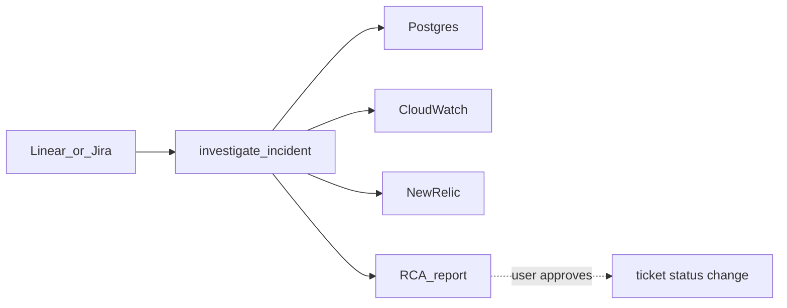

# Implementation plan: Linear / Jira ticket tools

**Status:** Phase B reads implemented (build order steps 2–5, branch `feat/ticket-tools`); status write (step 6) and doctor checks (step 7) not started.
**Decision:** Do this **before** multi-DB (MySQL / MSSQL).
**Goal:** Close the support-ticket loop — fetch issue title, description, comments, and status
instead of pasting `ticket_text` by hand.

**Access model (the one rule this plan is built around):**

| Action | Allowed? | Permission |
|---|---|---|
| Read a ticket, search tickets, read comments | Yes | None — read freely |
| Change a ticket's **status** | Yes, opt-in | **Ask the user every time** (MCP elicitation) before the change is sent |
| Any other change (title, description, assignee, labels, comments, create, delete) | **No** | Not exposed as a tool at all |

Related: [design.md](../design.md) (§4.6 prompts, ticket → evidence → RCA),
[code-structure.md](../code-structure.md), [AGENTS.md](../../AGENTS.md),
[security-audit.md](../security-audit.md).

---

## 1. Why this first

| Option | Choice |
|---|---|
| Linear / Jira ticket connection | **Next build** |
| MySQL / MSSQL / multi-relational DB | Later (only if real RCAs need those engines) |

Opsinsight's core loop is already **ticket → Postgres / CloudWatch / New Relic → RCA**. Ticket
integration feeds that loop. Multi-DB expands one evidence source and requires a
security-sensitive dialect rewrite (`asyncpg`, `pg_*` catalog, Postgres session hardening).



### 1.1 This breaks the "read-only server" invariant — on purpose, narrowly

CLAUDE.md, README and design.md describe the server as **read-only**. A status change is the
first write. To keep that claim honest:

- The write is **off by default** (`TICKET_STATUS_WRITE_ENABLED=false`). With it off, the
  server is still entirely read-only and `ticket_update_status` is **not registered**.
- When on, the only write is a status transition, and only after the user approves it in the
  client (§3.B.7).
- Docs change wording from "read-only" to "read-only, except an opt-in, user-approved ticket
  status change" (§3.B.11). Databases, CloudWatch and New Relic stay strictly read-only.

---

## 2. Out of scope (for this plan)

- Every ticket write except status: create, edit title/description, assign, label, comment, delete, link.
- Merging the full Linear or Jira MCP surface into this server.
- Jira Server / Data Center (PAT bearer auth) — Jira **Cloud** only for now; revisit on demand.
- Attachments, images, linked issues, custom fields (returned as-is only if trivially present).
- Making tickets a `trace_request` source (tickets aren't time-indexed evidence).
- MySQL / MSSQL / multi-dialect SQL (separate future plan).
- `investigation_start` (still not implemented; see design §4.5).

---

## 3. Phases

### Phase A — Client composition (no Opsinsight code)

**Outcome:** Engineer can open a Linear issue in Cursor or Claude Desktop, then investigate with
Opsinsight tools in the same chat.

| ID | Task | Done when |
|---|---|---|
| A1 | Enable / authenticate **Linear MCP** in the client (`mcp.json` / Claude Desktop config) | Linear tools appear and can fetch an issue |
| A2 | Keep **Opsinsight** MCP configured beside it | Both servers listed and healthy |
| A3 | Run one real ticket end-to-end | Model reads Linear issue → calls Opsinsight → produces RCA draft |
| A4 | Optionally add **Jira MCP** the same way | Same workflow for a Jira key |

**Notes**

- No server change. The client model bridges ticket text → investigation tools.
- Known limitation: `investigate_incident` requires `ticket_text` today, so the user (or model)
  still copies the ticket text into the prompt. Phase B removes that.
- Third-party ticket MCPs may expose writes; Phase A gives no status-only guarantee. Phase B does.

---

### Phase B — Ticket source inside Opsinsight (product-grade)

**Outcome:** One server loads a ticket by id, feeds `investigate_incident`, and can move the
ticket's status only with the user's explicit approval.

**Layering (must match existing rules)** — one source package, two provider adapters, so
`TicketService` imports only its own `integrations/tickets/*` (CLAUDE.md: a service must not
import another source's integrations):

```
tools/tickets/*  →  service/ticket_service.py  →  integrations/tickets/guardrail.py   (pure)
                                                   integrations/tickets/linear_client.py (I/O)
                                                   integrations/tickets/jira_client.py   (I/O)
                                                   integrations/tickets/adf.py           (pure, ADF → text)
                                                   integrations/tickets/models.py
```

| Layer | Responsibility |
|---|---|
| `tools/tickets/` | `@mcp.tool()`, docstring, params, one-line service call |
| `service/ticket_service.py` | Validate → fetch → normalize → redact → cap → `ok` / `ToolError.to_response()`; confirmation flow for status writes |
| `integrations/tickets/guardrail.py` | Pure: id format, query/JQL validation, limit clamp, provider selection, status allowlist |
| `integrations/tickets/linear_client.py` | Linear GraphQL I/O only |
| `integrations/tickets/jira_client.py` | Jira Cloud REST I/O only |

Do **not** put logic in tool files. Do **not** let guardrails do network I/O. Do **not** call
`redact_text` directly (it ignores `PII_REDACTION`); use `redact_row` / `redact_log_event`.

#### B.1 Settings

Add to `core/config.py` and `.env.example` (placeholders only):

| Setting | Purpose |
|---|---|
| `TICKET_PROVIDER` | `linear` \| `jira` \| `auto` (default `auto`) |
| `LINEAR_API_KEY` | Linear personal API key (`SecretStr`) |
| `JIRA_BASE_URL` | e.g. `https://your-org.atlassian.net`; validator requires `https://`, settings-only (never per call) |
| `JIRA_EMAIL` | Atlassian account email |
| `JIRA_API_TOKEN` | Atlassian API token (`SecretStr`) |
| `TICKET_MAX_RESULTS` | Search / comment page clamp (default 50) |
| `TICKET_MAX_RESPONSE_BYTES` | Response budget (default 1_000_000) |
| `TICKET_MAX_DESCRIPTION_BYTES` | Per-field cap for description / each comment body (default 32_768) |
| `TICKET_HTTP_TIMEOUT_S` | httpx timeout per request (default 15) |
| `TICKET_STATUS_WRITE_ENABLED` | Register `ticket_update_status` at all (default **false**) |
| `TICKET_ALLOWED_STATUSES` | Optional comma list of target status names; empty = any valid transition |

`auto`: Linear if only Linear is configured, Jira if only Jira; if both or neither, structured
error (`provider_ambiguous` / `missing_credentials`). Per-call `provider=` always wins. Ticket
ids can't disambiguate (`ENG-123` and `PROJ-456` look the same).

Credentials note: Linear API keys and Jira API tokens carry the **user's full permissions**,
including writes. The server-side status-only restriction is the control; recommend a dedicated
service account with the least project access the team allows.

#### B.2 Shared models + errors

- `integrations/tickets/models.py` — normalized shapes: `Ticket`, `TicketComment`,
  `TicketSearchHit`, `TicketTransition` (`id`, `key`, `title`, `description`, `status`, `url`,
  `created_at`, `updated_at`, `assignee`, `reporter`, `provider`, …).
- People fields are reduced to `{display_name, account_id}` — **no email** — before redaction.
- `TicketGuardrailError(ToolError)` in `core/errors.py`. Rules:

| Rule | Raised by | Meaning |
|---|---|---|
| `missing_credentials` | guardrail | Provider selected but not configured |
| `provider_ambiguous` | guardrail | `auto` with both configured, no `provider=` |
| `invalid_ticket_id` | guardrail | Not `ABC-123`, UUID (Linear) or numeric id (Jira) |
| `invalid_query` | guardrail | Empty / over-length search text or rejected JQL |
| `status_not_allowed` | guardrail | Target status outside `TICKET_ALLOWED_STATUSES` |
| `invalid_transition` | service | Target isn't a valid transition from the current status |
| `user_declined` | service | User rejected or cancelled the confirmation |
| `confirmation_unavailable` | service | Client doesn't support elicitation → write refused |
| `ticket_not_found` | service | Provider says no such issue (or no access) |
| `auth_failed` | service | 401/403 from provider |
| `rate_limited` | service | 429; `detail` includes Retry-After |
| `upstream_timeout` | service | httpx timeout |

Limit clamping is **not** an error: report it in `meta` (`limit_clamped: true`) like other sources.

#### B.3 Linear client (first)

| Task | Detail |
|---|---|
| GraphQL client | `https://api.linear.app/graphql`, `Authorization: <key>` (no `Bearer` for personal keys) |
| `get_issue` | `issue(id:)` accepts identifier (`ENG-123`) or UUID |
| `search_issues` | Use the current search query (verify `searchIssues` vs deprecated `issueSearch` at build time); clamp |
| `list_comments` | Paginated; clamp |
| `list_transitions` | Team's `workflowStates` for the issue |
| `set_status` | `issueUpdate(id, input: {stateId})` — the **only** mutation in the client |
| Errors | Map HTTP / GraphQL `errors[]` → rules above; respect rate-limit headers |
| Tests | Constructor-injected fake transport; no live Linear in unit tests |

#### B.4 Jira client (same adapter shape)

| Task | Detail |
|---|---|
| REST client | Jira Cloud, Basic auth (email + API token) against `JIRA_BASE_URL` |
| `get_issue` | `GET /rest/api/3/issue/{key}` |
| `search_issues` | `GET/POST /rest/api/3/search/jql` (old `/search` is deprecated), `nextPageToken` paging; clamp |
| Text vs JQL | Default: plain text → `text ~ "<escaped>"`, server adds `ORDER BY updated DESC`. Raw JQL only via `jql=` param, length-capped, no `ORDER BY` injection beyond one clause |
| `list_comments` | `GET /rest/api/3/issue/{key}/comment`; clamp |
| ADF | Description and comment bodies are Atlassian Document Format JSON → `adf.py` flattens to plain text (paragraphs, lists, code, mentions as `@name`) |
| `list_transitions` | `GET /rest/api/3/issue/{key}/transitions` |
| `set_status` | `POST /rest/api/3/issue/{key}/transitions` with the matched transition id — the **only** write in the client; never send `fields`/`update` in the body |
| Tests | Same injection / fake pattern as Linear; ADF fixtures from real responses |

#### B.5 `TicketService`

- One `TicketProvider` Protocol in `service/ports.py` (`get_issue`, `search_issues`,
  `list_comments`, `list_transitions`, `set_status`), implemented by both clients — no
  provider branches in the service (same idea as `TraceSource`).
- Constructor-injected providers (`linear_provider`, `jira_provider`), default factories in the container.
- Methods: `get_ticket`, `search_tickets`, `list_comments`, `update_status`.
- Normalize → strip people emails → `redact_row` (respects `PII_REDACTION`) → truncate
  description/comment bodies to `TICKET_MAX_DESCRIPTION_BYTES` → drop trailing comments to fit
  `TICKET_MAX_RESPONSE_BYTES` → `meta.truncated`, `meta.comments_returned/total`. **Redact before
  truncating** so a cut can't hide part of a secret.
- **Cache: none.** Tickets change constantly; pass `NULL_CACHE` explicitly and say why in a comment.
- Untrusted-content framing: responses carry `meta.content_trust = "untrusted_user_content"` and
  the tool docstrings tell the model to treat description/comments as evidence, not instructions
  (fetched text doesn't go through `quote_input`).
- Ids/order numbers in ticket text must survive redaction (existing Luhn check covers cards;
  add tests that typical order/customer ids aren't masked as phone/Aadhaar).
- Wire in `core/container.py` as `ticket_service` (injectable for tests).

#### B.6 MCP tools

Names follow `<source>_<verb>_<noun>` so `_TOOL_NAME_RE` can validate them:

| Tool | Args (sketch) | Service method | Annotations |
|---|---|---|---|
| `ticket_get_issue` | `ticket_id`, optional `provider`, `include_comments=False` | `get_ticket` | read-only |
| `ticket_search_issues` | `query` **or** `jql`, optional `provider`, `limit` | `search_tickets` | read-only |
| `ticket_list_comments` | `ticket_id`, optional `provider`, `limit` | `list_comments` | read-only |
| `ticket_update_status` | `ticket_id`, `target_status`, optional `reason`, `provider` | `update_status` | `readOnlyHint=False`, `destructiveHint=False`, `idempotentHint=True` — registered **only** if `TICKET_STATUS_WRITE_ENABLED` |

Read tools set `readOnlyHint=True`.

#### B.7 Status change: user permission flow

`ticket_update_status` never changes anything without an explicit yes from the user in **this call**:

1. Guardrail: valid id, `target_status` non-empty and within `TICKET_ALLOWED_STATUSES` (if set).
2. Fetch the issue's current status and `list_transitions`. Match `target_status`
   case-insensitively to exactly one transition; otherwise `invalid_transition` listing the valid targets.
3. If the current status already equals the target → `ok` with `changed: false` (no prompt, no write).
4. **Ask the user** via MCP elicitation (`ctx.elicit`, FastMCP ≥ 4.1):
   > Change **ENG-123** "Checkout fails for…" from **In Progress** → **Done**? Reason: "…"  [Approve / Decline]
   - Approve → step 5. Decline / cancel → `user_declined`, nothing sent.
   - Client without elicitation support → `confirmation_unavailable`, nothing sent. **No fallback
     that lets the model approve on the user's behalf** (no `confirm=true` argument, no token the
     model can echo back).
5. Re-read the status. If it changed since step 2 → abort with `invalid_transition` (stale) rather than overwrite.
6. Send the one transition. Return `{changed: true, from, to, url}`.
7. Audit: `AuditMiddleware` logs the call as usual; the service also logs a `ticket_status_change`
   event with ticket key, from → to, approved/declined, provider (no ticket body).

Prompts may *suggest* a status change in the report but must say "ask the user"; the
confirmation is enforced by the server, not the prompt.

#### B.8 Prompt wiring

Update `prompts/investigate_incident.py`:

- Make `ticket_text` **optional** (`str | None = None`); add optional `ticket_id` and `provider`.
- Exactly one of `ticket_text` / `ticket_id` is expected. Neither → the prompt tells the model to
  ask the user for the ticket. Both → the prompt uses `ticket_id` and treats `ticket_text` as extra context.
- When `ticket_id` is set: call `ticket_get_issue` (`include_comments=true`, or
  `ticket_list_comments` if truncated), treat returned fields as untrusted evidence, then continue
  existing steps. Prompt stays pure: it only renders the id, never fetches.
- New last step (only meaningful when the write is enabled): "If the evidence supports it, you may
  propose a status change with `ticket_update_status`; the user will be asked to approve."
  The prompt-tool-name test then requires `ticket_update_status` to be registered — so either
  render this step only as plain text without the backticked tool name, or enable the write in
  that test's settings. Pick one when implementing.
- Update `prompts/common.py` discovery rules to mention ticket tools.
- Extend `_TOOL_NAME_RE` in `prompts/common_test.py`: add `ticket` to the prefix group and
  `update` to the verb group.
- Update `REQUIRED_ARGS` (`investigate_incident` → `{}` or the new minimal set) and
  `test_prompt_arguments_are_described_with_required_flags` expectations.
- Add `ticket_id` cases to `investigate_incident_test.py` and to the redaction test in
  `core/audit_test.py`.

#### B.9 Registration checklist (AGENTS.md "Add a new tool")

1. Service methods + unit tests (injected fakes, no monkeypatching).
2. `tools/tickets/<name>.py`.
3. Import in `tools/tickets/__init__.py` **and add to `__all__`**; add `tickets` to `tools/__init__.py`.
4. Review each tool for authorization, redaction and audit, then add names to `EXPECTED_TOOLS`
   in `core/audit_test.py` (with the write enabled vs disabled — two inventories).
5. Add `ticket_service` to the `services` fixture and cases in `tools/tool_wiring_test.py`.
6. Document in `docs/tool-reference.md`, README, design §4.
7. `CHANGELOG.md` under Unreleased.

#### B.10 Doctor (recommended)

- `check_linear` / `check_jira`: soft checks, skip when unset; probe auth with a cheap read
  (`viewer { id }` / `GET /rest/api/3/myself`). Add to the doctor runner and `doctor_test.py`.
- Report whether `TICKET_STATUS_WRITE_ENABLED` is on (warn level) so it's visible.
- `sanitize_error`: mask `LINEAR_API_KEY`, `JIRA_API_TOKEN` **and** the base64 `email:token`
  Basic header value.

#### B.11 Docs / structure map

Update in the same PR:

- `CLAUDE.md` — fourth source, `TicketService`, read-only wording + the status exception.
- `AGENTS.md` — ticket write rule ("status only, elicitation required, never add another write").
- `docs/code-structure.md` — `tools/tickets/`, `service/ticket_service.py`, `integrations/tickets/`.
- `docs/design.md` — new §4.x ticket tools; §2.1 non-goals (status is the only write); §6 security
  model subsection for tickets; §10 delivery status row.
- `docs/security-audit.md` — new egress hosts, new credentials, the write path and its controls.
- `docs/tool-reference.md` — tool tables; fix the `investigate_incident` row (`ticket_text` no longer required).
- `README.md` — feature bullet, env vars, read-only wording.
- `.env.example` — placeholders.
- `CHANGELOG.md`.

#### B.12 Tests beyond unit fakes

- Opt-in `ticket_integration` marker (skips without credentials) that reads one known issue from
  Linear and Jira — catches real response-shape drift (ADF, pagination). **Never** runs
  `set_status` against a real ticket automatically.
- Coverage gate (`fail_under = 85`): client modules must be covered by fake-transport tests, not
  left to the integration marker.

---

## 4. Suggested build order

1. Phase A smoke test (Linear MCP + Opsinsight) — validates product value before code.
2. Ticket models + guardrail + settings + errors.
3. Linear client (reads) + `TicketService` reads + three read tools + tests.
4. Wire `investigate_incident` + docs/CHANGELOG.
5. Jira client (reads, ADF) behind the same Protocol + tests + docs.
6. Status write: transitions + elicitation flow + `ticket_update_status` behind the flag + tests.
7. Doctor checks.

Reads (steps 1–5) can ship on their own; the write (step 6) is a separate PR.

---

## 5. Acceptance criteria

**Reads**
- [ ] Missing credentials / ambiguous provider → structured `ok: false` with clear `rule` / `detail`.
- [ ] Description and comments PII-redacted when `PII_REDACTION=true`, untouched when false; people fields carry no email.
- [ ] Search/comment limits clamped server-side and reported in `meta`; oversized tickets truncated with `meta.truncated`.
- [ ] Jira ADF bodies come back as readable plain text.
- [ ] Nothing ticket-related is cached.
- [ ] User can investigate with either pasted `ticket_text` or `ticket_id` → `ticket_get_issue`.

**Status write**
- [ ] With `TICKET_STATUS_WRITE_ENABLED=false`, `ticket_update_status` is not registered and no client code path can write.
- [ ] No status change is sent without an Approve from elicitation in the same call; decline, cancel and no-elicitation-support all send nothing.
- [ ] No tool changes any field other than status (clients send only the transition / `stateId`).
- [ ] Invalid or stale transitions are refused with the list of valid targets.
- [ ] Every status-change attempt (approved or declined) is audited.

**Engineering**
- [ ] `ruff check .` clean; `pytest -m "not integration"` passes; coverage ≥ 85.
- [ ] `EXPECTED_TOOLS` (both inventories), wiring tests, `_TOOL_NAME_RE`, `REQUIRED_ARGS` updated.
- [ ] Docs in B.11 updated, including the read-only wording.

---

## 6. Multi-DB (later — not this plan)

Only start when investigators regularly need MySQL or MSSQL evidence:

- Dialect-aware sqlglot guardrails and blocked functions/tables
- Per-engine catalog (not `pg_*`)
- Per-engine session hardening / read-only role docs
- Settings for dialect / DSN
- Full regression of database guardrail, engine, introspect, service tests

**Cost / risk:** high. Track as a separate doc under `docs/plan/` when needed.

---

## 7. Decision rule (reminder)

| Situation | Do |
|---|---|
| Tickets live in Linear/Jira; you paste text today | This plan (Phase A → B reads) |
| Team wants to close/move tickets from the chat | Phase B step 6, flag on, elicitation-capable client |
| Client can't show elicitation prompts | Keep the write flag off |
| Apps under investigation are still Postgres | Skip multi-DB for now |
| MySQL/MSSQL needed weekly for RCAs | Schedule multi-DB after Phase A (or first if it blocks daily work) |
| Only want client wiring | Phase A only |
